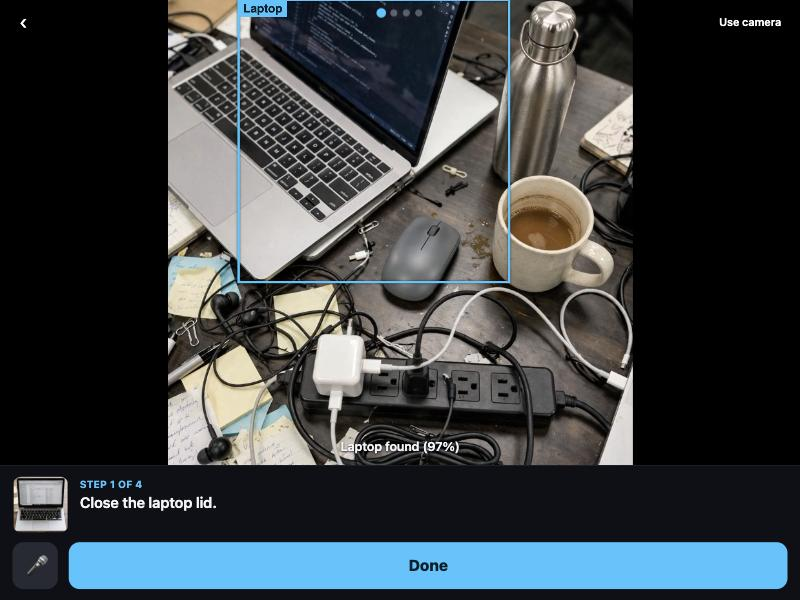
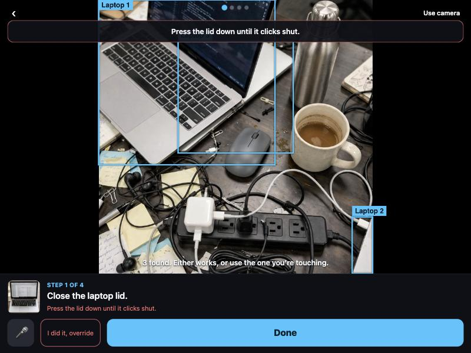
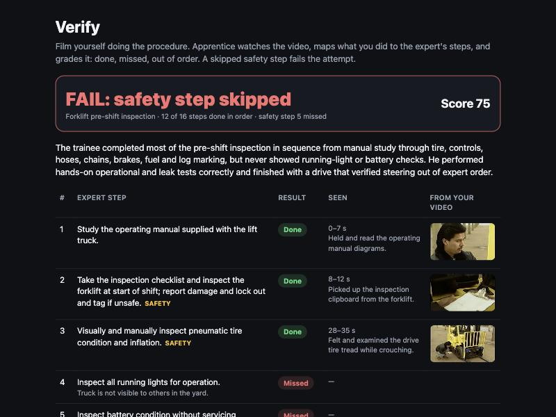

# Apprentice — Watch it once. Do it yourself.

Apprentice turns one phone video from the person who knows how into a guide anyone can follow on the real machine.
Point your phone at it; the AI finds each part, checks your work, and answers questions. Film yourself doing it and
Apprentice grades you against the expert.

**Spark understands, SAM finds, Spark checks, Voice Transcribe listens.**

**Try it (30 seconds):** run `scripts/serve.sh`, open the printed https link on your phone, choose *Desk demo*,
point at your desk. No camera? Choose *Watch on sample footage* for the forklift.

Meta Global AI Developer Hackathon, Oct 26 – Nov 4, 2026. Startup track, theme *Push the Frontier*.
Everything in this repo was built during the hackathon, from an empty repo on Oct 26. Frame Sixty's prior work is
VR training sims delivered by hand; none of that code is here. (The repo is still named `vid2sim` on GitHub.)

## One-command run

```bash
python3 -m venv .venv && .venv/bin/pip install -r backend/requirements.txt
cp .env.example .env          # paste MODEL_API_KEY from https://dev.meta.ai/platform
.venv/bin/python backend/run.py data/procedures/p1/p1.mp4
```

Out: `spec.json`, `transcript.json`, `review.json`, `bundle/` (crops, masks, cutouts) and `metrics.json` next to the
video. Add `--mock` to run the whole chain with no key and no cost (real SAM protocol text, canned model answers).

Then serve it, with HTTPS for the phone:

```bash
scripts/serve.sh              # backend on :8000, Cloudflare quick tunnel, prints the https link and a QR code
```

Dashboard at `/`, Guide at `/guide/`, Verify at `/guide/verify.html`. `cd dashboard && npm run build` after
editing the dashboard (the backend serves `dashboard/dist`); `scripts/metrics_card.py` prints the metrics card.

| Guide: the part boxed on the camera | Done: Spark says not yet, with the expert's line | Verify: a skipped safety step fails |
| --- | --- | --- |
|  |  |  |

## How it works

1. **Capture.** A trainer films the procedure once, narrating. 30 s to 3 min, MP4, faststart.
2. **Understand.** Narration goes through **Muse Voice Transcribe** (Spark 1.3's audio path is flagged degraded,
   so it never hears audio). **Muse Spark 1.3** reads the frames plus the frame-stamped transcript and returns the
   procedure as structured JSON against `backend/schema/procedure.schema.json`. A second pass flags any step the
   narration does not support.
3. **Segment.** **SAM 3.1**, one request per part on a frame-accurate trim of that part's step range. Concept
   prompt first; if it returns nothing or mean confidence < 0.5, Spark returns a box on the keyframe and SAM
   re-runs with `propagation_direction: forward`. `source` on each part records which path found it.
4. **Review.** The trainer sees the steps and the masks in the dashboard, renames a part, fixes a phrase SAM
   missed on ("add a colour or shape word"), reorders a step, and saves. Guide reads the saved spec on the next load.
5. **Guide.** The trainee opens `/guide/` on a phone and points it at the real machine. The current step's
   `prompt_phrase` goes to **SAM 3.1** on live camera frames and the real part gets a box; tapping Done (or saying
   "done") sends the frame to **Spark 1.3** with the step's `check` text, which advances, coaches, or asks for a
   closer look; a question into the mic goes through **Voice Transcribe** to Spark and comes back spoken.
6. **Verify.** The trainee films themselves doing it. The same pipeline runs on their video with the expert's steps
   in the prompt, and the report says done / missed / out of order per step; a skipped safety step fails the attempt.

## Guide mode (Oct 31 pivot: the phone, not the headset)

Apprentice guides the trainee on the real machine through a phone camera. Open `/guide/` on a phone (HTTPS is
required for the camera; `cloudflared tunnel --url http://127.0.0.1:8000` gives one in seconds), pick a procedure,
point at the thing. Every second a frame goes to `POST /guide/find`, which runs **SAM 3.1** on that one image with
the current step's `prompt_phrase` and returns boxes in the frame's own pixels; the page draws them and clears them
on every response so a moved camera never shows a stale box. The step card shows the instruction, the part's
keyframe crop and a Done button; results are saved to `data/sessions/`. "Watch on sample footage" runs the same
loop over a pre-recorded video for anyone without a camera. Day-1 numbers: 500 to 1900 ms per frame, median
about 820 ms, $0.0025 a frame; laptop, water bottle and mouse at 0.95+ confidence on desk photos. Code:
`backend/guide.py`, `backend/static/guide/`. Tapping Done sends the current frame to `POST /guide/check`, where
**Muse Spark 1.3** answers whether the step's `check` statement is true in that photo (yes advances, no shows the
step's coach line and offers a logged override, unclear asks for a closer look); 7/7 on desk photos, 1.6 to 2.4 s,
about $0.002 a check. The mic button turns on listening: 3 s segments go to `POST /guide/hear`, **Muse Voice
Transcribe** returns the words, and "done" / "next" / "finished" runs the step check hands-free while anything
phrased as a question goes to `POST /guide/ask`, where Spark answers in one spoken sentence with the spec and the
current frame as context ("which one is the water bottle?" → "the blue bottle on the right side of the desk",
about 2 s). `data/guide.json` orders the landing page: featured procedures first with a blurb, the rest under
"More procedures"; a "Sample footage" switch in the guide runs the same loop on a pre-recorded video.

## Verify mode (grade a trainee's video)

The pipeline already turns a video into a step list, so `backend/pipeline/verify.py` runs it on the trainee's
video with the expert's steps in the prompt: Spark lists every action it sees and the expert step each one
accomplishes, `diff()` marks each expert step done / out of order / missed (longest in-order run counts as done),
score = steps done in order / total, and a missed safety step fails the attempt whatever the score. Upload at
`/guide/verify.html`, or `POST /verify/{procedure}` with the video; the report has a thumbnail from the trainee's
own video per matched step, prints to PDF, and its URL is the shareable link. Under a dollar per video.

## Repo layout

```text
backend/
  run.py                  one command: video -> spec -> StreamingAssets
  app.py                  FastAPI: upload, run, status, spec get/put, build
  schema/procedure.schema.json   the contract (frozen 1.0)
  pipeline/
    transcribe.py         Voice Transcribe -> transcript.json
    extract.py            Spark 1.3 -> draft spec (two passes)
    segment.py            SAM 3.1 per part, trim, box fallback, meta-sam-parser
    bundle.py             keyframes, crops, size hints, mask PNGs, spec.json
    verify.py             Verify: Spark maps the trainee's video to the expert steps, diff, score, safety fail
    cutouts.py            RGBA photo cards per part (SAM mask on the crop)
    generate.py / package.py   Muse Code models and the StreamingAssets payload for the archived Unity sim
    validate.py / metrics.py / common.py
  guide.py                Guide: SAM on one camera frame, Spark step check, voice intents, Spark Q&A
  static/guide/           the phone page (index.html, guide.js) and the Verify report page (verify.html)
  mock/                   canned responses for VID2SIM_MOCK=1
  tests/                  pytest, 21 tests: full mock run, guide routes, verify rules and routes
dashboard/                React + Vite (spec review and edit, Guide / Verify buttons)
scripts/                  serve.sh (backend + HTTPS tunnel + QR), metrics_card.py
data/procedures/<id>/     p.mp4 (not committed), transcript.json, spec.json, bundle/, ground_truth.json, sample.mp4
data/guide.json           landing page order and blurbs;  data/sessions/  Guide and Verify results
archive/unity/            the pre-pivot VR sim (see archive/README.md)
metrics/runs.csv          run_id, procedure, stage, model, wall_s, cost_usd, frames, tokens
```

## Spec contract

`procedure.schema.json` is read by the pipeline (writer), the dashboard (editor) and the engine (reader),
validated on every write and load. Rules the engine depends on:

- `steps[].action` is a closed vocabulary: `press grab pull lift place turn_cw turn_ccw inspect`. Anything else
  goes in `custom_action` and is a Muse Code generation candidate.
- `parts[].interaction` picks the Interaction SDK component: `press` → PokeInteractable, `turn` → HandGrab +
  OneGrabRotateTransformer, else HandGrabInteractable.
- `parts[].box` is in source-video pixels, inclusive x2/y2, exactly as SAM reports it. Never scaled.
- `parts[].source` is `concept`, `box` or `manual`. That's a metric.
- `steps[].safety: true` cannot be skipped; skipping ends the attempt with a fail.

## Metrics

`scripts/metrics_card.py` prints the live card (capture minutes and dollars per procedure, SAM hit rate and
round-trip on phone frames, Spark check verdicts, voice, Verify results, total spend) straight from
`metrics/runs.csv` and `data/sessions/`. The capture table below is the pre-pivot record of the same pipeline on
public-domain test films; "upload → playable" includes the archived sim's Muse Code generation, which Guide does not need.

| Procedure | Upload → playable | API cost | Steps correct vs ground truth | Parts: text / box / manual |
| --- | --- | --- | --- | --- |
| Forklift pre-shift inspection, 133 s, 720×480, narrated 2005 Oregon OSHA film, public domain (CC0) | 15.6 min over two passes (segment, then generation incl. a compile gate for 14 Muse Code part models) | $2.98 | 10/12, 4 finer-grained extras | 8 / 4 / 2 |
| M151 engine, left-side connections, 112 s, 720×480, narrated 1960s DoD film, public domain | 11.6 min incl. a 2 min compile gate | $1.57 | 8/11, 6 finer-grained extras | 2 / 11 / 3 |
| Deep-sea diving outfit, helmet fitting, 196 s, 720×480, narrated 1963 DoD film, public domain | 18.8 min incl. an aborted gate pass | $3.67 | 8/10, 14 finer-grained extras | 4 / 8 / 3 |
| Nazava water-filter install, 79 s, 848×480, narrated, CC BY test clip | 9.6 min single pass (14.6 min incl. a code-gen rerun) | $1.21 | 6/7, 1 extra | 3 / 2 / 2 |
| MSI Trident GPU swap, 260 s, 1080p, no narration, CC BY test clip | 24.1 min incl. two crash-and-resume passes | $2.39 | 5/7, 9 finer-grained extras; verify correctly flagged 1 invented step | 3 / 7 / 2 |
| synthetic colour-bar clip, 6 s (chain check only) | 2.8 min | $0.32 | n/a | 0 / 0 / 5 |
| compressor-filter-swap (Sean's own footage) | _tbd_ | _tbd_ | _tbd_ | _tbd_ |

All test clips are attributed in `data/procedures/*/ATTRIBUTION.md` and are never part of the demo. The forklift film is Oregon OSHA's
(CC0 on the archive), the M151 and diving films are US Department of Defense works (public domain, CC0 on the archive); the other two are CC BY from Wikimedia Commons. Numbers are
aggregated over every run of that clip (resumed stages cost $0 and 0 s); the per-stage rows are in `metrics/runs.csv`.
Rendered card: `docs/metrics-card.png`.

Notes on the M151 run (`data/procedures/m151-power-pack/metrics.json`), public-domain footage:

- Voice Transcribe turned a 1960s narrator into 53 timed turns that read like the manual. Spark extracted 16 steps
  and 16 parts; 10 of 11 trainer steps aligned, 8 with the right action. The misses are honest: "remove the muffler
  inlet pipe" came back as `disconnect` where the list says `turn_ccw`, and the brush guard at the clip's end was
  not extracted.
- Black-and-white footage is where the box fallback earns its place: text prompts found 2 parts, Spark boxes
  rescued 11 more, 3 stayed manual.
- First run with the Muse Code compile gate on: three generated verbs (`disconnect`, `remove`, `detach`) were
  compiled by a headless Unity before landing. The gate adds about two minutes to the wall time.

Notes on the diving-helmet run (`data/procedures/dive-helmet-fitting/metrics.json`), public-domain footage, a
piece of equipment nothing like an engine:

- The 24-minute source exposed Voice Transcribe's 10-minute batch limit; audio is now chunked and merged with
  offsets, and the whole film came back as 149 timed turns.
- Spark extracted 24 steps and 15 parts; 10 of 10 trainer steps aligned, 8 with the right action. On the first pass
  it set a custom verb on 14 steps (lead, drop, slip, tighten, tie...) that the vocabulary already covers, which
  cost $1.40 of pointless code generation. Synonyms now fold onto the vocabulary before any script is written.
- The compile gate had passed, but Unity 6 crashed on exit after the batch run and the gate read that as failure;
  the verdict now comes from the log.
- SAM found 12 of 15 parts (4 by text prompt, 8 by box fallback) on 1963 black-and-white footage.

Notes on the Nazava run (`data/procedures/nazava/metrics.json`):

- Voice Transcribe returned 7 frame-stamped turns that match the clip's own subtitle track almost word for word.
- Spark 1.3 extracted 8 steps in the right order with sensible coach lines and flagged 3 as safety steps; the verify
  pass flagged one step's wording against the narration. Ground truth here was written from the clip's subtitles by
  the pipeline author, not a trainer, so treat the 6/7 as a sanity check rather than a claim.
- SAM 3.1 found the upper container (464 frames, mean c 0.83), ceramic filter (102 frames) and lower container
  (94 frames) from the text prompt alone. The base stand and tube went through the box fallback; the tube box is
  wrong (Spark boxed the container in the presenter's hands), which the dashboard overlay shows at a glance. The
  rubber seal and the lid were found by neither path and are marked `manual` for the trainer to draw.

Notes on the GPU-swap run (`data/procedures/trident-gpu-swap/metrics.json`), the Nov 2 "different machine,
zero code changes" test:

- No narration at all (the transcript is the word "Nice."). Spark 1.3 read the burned-in captions and extracted
  15 steps and 12 parts in order; our 7-step ground truth is coarser, so 9 extracted steps count as extras.
- The verify pass, given the video as evidence when the transcript is thin, cited the caption behind each of 14
  steps and flagged the 15th ("place the replacement card") as never shown: the trim ends before the install.
  That is a hallucinated step caught before it reached a trainee.
- SAM found 10 of 12 parts, 7 of them only through the box fallback (screws, cables, covers at 0.84 to 0.99
  confidence). The CPU cooler and the new card were found by neither path.
- It did not run with zero code changes. It found that meta-sam-parser validates every mask on push in pure
  Python (8 CPU minutes for one 1080p part), that a 1080p PNG keyframe stalls the box fallback, and a NameError
  in the texture stage the mock tests had not reached. All three fixes are in the pipeline, none in the spec.
- Spark's reasoning shares its output budget: at 6000 tokens the first Nazava extraction returned nothing, and at
  8000 the three generated C# scripts came back empty. Both now default to 16000 with one retry at double.

Prices used: Spark $1.25/M in, $4.25/M out; SAM $0.20 per 1k frames, 50-frame minimum per request.
Transcribe and Image rows are labelled estimates until Billing confirms the unit price.

## Risks we designed around

| Risk | Mitigation |
| --- | --- |
| Spark merges or misreads steps | Structured output against a fixed schema; second pass verifies each step against the transcript; dashboard review catches the rest |
| SAM's text prompt misses an industrial part | Box fallback from Spark on the keyframe, or the trainer draws one in the dashboard. Zero matches is a branch, never a crash |
| Two identical parts on the machine | SAM returns both; Guide draws both and says "2 found, either works". It never guesses |
| Part not visible from the trainee's angle | Zero matches is a state, not an error: "Finding the X…" with the keyframe crop, then "try moving closer or to the side" |
| 1 to 2 s round trip on a live frame | Boxes are cleared on every response; one request in flight; the UI never calls it AR tracking |
| Spark judges a step wrongly from one frame | Checks are written as visible binary states; the trainee can override once per step and overrides are logged and shown in Verify |
| Spark 1.3 audio is degraded | Narration goes through Voice Transcribe; Spark gets frames plus text |
| Rebuilding the machine in 3D looked like primitives | We stopped rebuilding it: Guide works on the real machine through the camera (the VR sim is archived) |

## Archive

The pre-pivot VR training sim (Unity engine, Muse Code part models, exam mode, Quest and WebGL builds) lives under `archive/unity` with its own [README](archive/README.md). It is not part of the demo.

## Docs

- [docs/HANDOFF.md](docs/HANDOFF.md): what is done and what is left, as of the Oct 31 pivot
- [docs/SUBMISSION.md](docs/SUBMISSION.md): the submission page text with the measured numbers
- [docs/VIDEO.md](docs/VIDEO.md): 3-minute shot list timed against the rubric, X post
- [docs/FILMING.md](docs/FILMING.md): how to shoot and narrate so footage is pipeline-ready
- [docs/metrics-card.png](docs/metrics-card.png): rendered by `scripts/metrics_card.py --png` from `metrics/runs.csv` and the sessions
- [docs/screens/](docs/screens/): Guide and Verify as they look today (sample footage, Oct 31)

## Development

Feature branches, one PR per component, merged to `main`. CI runs the backend tests and the dashboard build.

```bash
.venv/bin/python -m pytest backend/tests -q
cd dashboard && npm run build
```

Raw video is never committed. Footage links: _tbd_.
